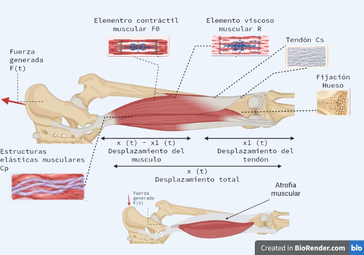
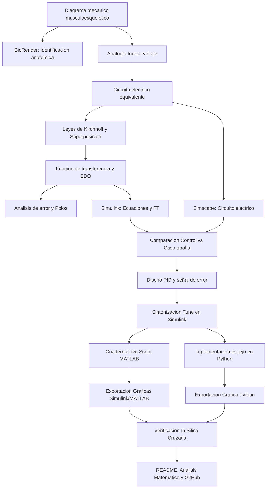

[](https://matlab.mathworks.com/open/github/v1?repo=DrPaulValle/MSFBP0)

# Práctica 3 — Modelado y control del sistema musculoesquelético

Repositorio académico de la asignatura **Modelado de Sistemas Fisiológicos**, correspondiente al programa de **Ingeniería Biomédica** del Tecnológico Nacional de México / Instituto Tecnológico de Tijuana. Esta práctica integra el modelado matemático de las propiedades viscoelásticas del sistema musculoesquelético, la conversión mediante analogías electromecánicas (fuerza-voltaje), el análisis temporal, la simulación *in silico* y el diseño de un controlador PID para compensar un caso simulado de atrofia muscular.

El caso de estudio contrasta la respuesta mecánica de un **individuo sano (control)** frente a un **paciente con atrofia muscular (caso)**, representada por un incremento en la resistencia viscosa del tejido. Se busca reproducir el comportamiento dinámico mediante simulaciones en MATLAB, Simulink y Python, y diseñar un lazo de control que obligue al modelo con atrofia a seguir la respuesta del individuo sano.

**Docente:** Dr. Paul Antonio Valle Trujillo  
**Correo:** paul.valle@tectijuana.edu.mx  
**Departamento:** Ingeniería Eléctrica y Electrónica  
**Institución:** Tecnológico Nacional de México / Instituto Tecnológico de Tijuana  
**Asignatura:** Modelado de Sistemas Fisiológicos  
**Programa:** Ingeniería Biomédica  
**Estudiante:** Nombre completo · Número de control · correo@tijuana.tecnm.mx

**Repositorio de la asignatura:** https://github.com/DrPaulValle/MSF-IBF1020  
**Sede:** Blvd. Alberto Limón Padilla s/n, Tijuana, C. P. 22454, B. C., México.

---

<a id="contenido"></a>
## Contenido

1. [Resumen](#resumen)
2. [Competencia y objetivos](#objetivos)
3. [Relación con el temario](#temario)
4. [Modelo físico y analogía eléctrica](#analogia)
5. [Formulación matemática](#modelo)
6. [Análisis temporal y de estabilidad](#analisis)
7. [Señales de entrada y condiciones de simulación](#senales)
8. [Implementación en MATLAB, Simulink y Simscape](#matlab)
9. [Control en lazo cerrado y sintonización PID](#pid)
10. [Reproducción en Python](#python)
11. [Diagrama biológico (BioRender)](#biorender)
12. [Resultados y verificación cruzada](#resultados)
13. [Flujo de trabajo](#flujo)
14. [Actividades del estudiante](#actividades)
15. [Estructura del repositorio](#estructura)
16. [Requisitos](#requisitos)
17. [Reproducibilidad y entregables](#reproducibilidad)
18. [Referencias](#referencias)

---

<a id="resumen"></a>
## Resumen

La práctica tiene como propósito **reproducir un procedimiento completo de modelado, análisis, simulación y control** del sistema musculoesquelético utilizando experimentación exclusivamente *in silico*. Las propiedades viscoelásticas del músculo se aproximan mediante una combinación de elementos contráctiles, resortes (compliancias $C_s, C_p$) y amortiguadores (resistencia $R$), los cuales se transforman a un circuito eléctrico equivalente empleando la analogía fuerza-voltaje. 

Se estudian y comparan matemáticamente dos escenarios: un individuo sano (control) y un caso de atrofia muscular (caso), analizando su error en estado estacionario y estabilidad. Posteriormente, se evalúa la respuesta al impulso unitario en MATLAB, Simulink, Simscape y Python. Se incorpora un **controlador PID** utilizando la respuesta del individuo sano como señal de referencia, buscando reducir la diferencia de desplazamiento generada por la atrofia muscular. Finalmente, se correlacionan los elementos matemáticos con la anatomía real mediante un diagrama esquemático en BioRender.

**Palabras clave:** analogía fuerza-voltaje; atrofia muscular; controlador PID; sistema musculoesquelético; BioRender; MATLAB; Simulink; Simscape Electrical; Python; simulación *in silico*.

[Volver al contenido](#contenido)

---

<a id="objetivos"></a>
## Competencia y objetivos

### Competencia a desarrollar

Modeliza sistemas fisiológicos mediante analogías entre sistemas físicos, ecuaciones diferenciales y funciones de transferencia para analizar su comportamiento dinámico y diseña estrategias de control mediante técnicas de control clásico. En particular, el estudiante analiza un modelo mecánico simplificado del sistema musculoesquelético, construye su equivalente eléctrico, compara un individuo sano con un caso de atrofia y diseña un control para reducir sus diferencias.

### Objetivo general

Reproducir y verificar el modelo viscoelástico del sistema musculoesquelético mediante su formulación matemática, implementación computacional *in silico*, y control con retroalimentación, comparando las respuestas de un individuo sano y uno con atrofia ante una entrada de fuerza.

### Objetivos específicos

- Identificar los elementos mecánicos (amortiguadores, resortes, elementos contráctiles) y establecer su analogía eléctrica.
- Obtener la función de transferencia del sistema aplicando las leyes de equilibrio y el principio de superposición.
- Determinar el error en estado estacionario y analizar la estabilidad mediante los polos del sistema.
- Simular el modelo (control y caso) en lazo abierto usando ecuaciones, función de transferencia y Simscape Electrical.
- Implementar un controlador PID que utilice la respuesta sana como referencia para el caso con atrofia.
- Reproducir las respuestas de lazo abierto y lazo cerrado mediante MATLAB (Cuaderno Live Script) y Python.
- Elaborar un diagrama biológico en BioRender que vincule los elementos mecánicos con las estructuras anatómicas.
- Documentar los resultados, gráficas y análisis matemáticos en un repositorio de GitHub.

[Volver al contenido](#contenido)

---

<a id="temario"></a>
## Relación con el temario

La práctica integra contenidos correspondientes a tres unidades de la asignatura **Modelado de Sistemas Fisiológicos (IBF-1020)**:

| Unidad | Área | Contenidos aplicados |
|---|---|---|
| I | Sistemas de control retroalimentados | Diagramas de bloques, respuesta al impulso, análisis de error estacionario, uso de un modelo de referencia sano. |
| II | Modelado matemático | Analogía mecánica-eléctrica (fuerza-voltaje), principio de superposición, funciones de transferencia de 1.er orden. |
| III | Controladores | Diseño de estrategia *in silico*, sintonización de ganancias del PID para seguimiento de trayectoria biológica. |

[Volver al contenido](#contenido)

---

<a id="analogia"></a>
## Modelo físico y analogía eléctrica

El comportamiento viscoelástico del compartimento musculoesquelético se aproxima mediante un arreglo mecánico que posteriormente se transforma usando la **analogía fuerza-voltaje**. 



| Sistema mecánico | Sistema eléctrico equivalente | Interpretación fisiológica |
|---|---|---|
| Fuerza $F(t)$ | Voltaje $V(t)$ | Fuerza transmitida por el sistema |
| Velocidad $dx(t)/dt$ | Corriente $I(t)$ | Tasa de cambio del tejido |
| Desplazamiento $x(t)$ | Carga eléctrica $q(t)$ | Deformación / elongación muscular |
| Amortiguador | Resistencia $R$ | Amortiguación viscosa del tejido |
| Compliancia mecánica | Capacitancia $C$ | Propiedades elásticas (tendones, sarcolema) |
| Masa | Inductancia $L$ | Inercia (no aplica en este modelo simplificado) |

*Nota sobre topología:* Los componentes mecánicos conectados en paralelo se representan en serie en el circuito eléctrico, y los conectados en serie se representan en paralelo. Además, la fuerza del elemento contráctil activo se denota como $F_0(t) = \alpha F(t)$.

### Parámetros de simulación (Control vs Caso)

La diferencia clínica entre un estado sano y la atrofia se simula modificando la componente viscosa $R$:

| Parámetro | Control (Individuo sano) | Caso (Atrofia muscular) |
|---|:---:|:---:|
| $F(t)$ | $1\,\mathrm{V}$ | $1\,\mathrm{V}$ |
| $\alpha$ | $0.25$ | $0.25$ |
| $C_s$ | $10\,\mu\mathrm{F}$ | $10\,\mu\mathrm{F}$ |
| $C_p$ | $100\,\mu\mathrm{F}$ | $100\,\mu\mathrm{F}$ |
| $R$ | $100\,\Omega$ | $10\,\mathrm{k}\Omega$ |

[Volver al contenido](#contenido)

---

<a id="modelo"></a>
## Formulación matemática

A partir de las ecuaciones de nodo/malla del circuito equivalente y aplicando el principio de superposición para las dos fuentes ($F(t)$ y $F_0(t)$), se obtiene el modelo dinámico en el dominio de Laplace. 

De acuerdo con el análisis matemático desarrollado, considerando $F_0(t) = \alpha F(t)$ y resolviendo para la relación de la salida respecto a la fuerza de entrada, se llega a la siguiente función de transferencia:

$$
\boxed{G(s) = \frac{F_S(s)}{F(s)} = \frac{R C_s s + 1 - \alpha}{(R C_p + R C_s)s + 1}}
$$

El denominador revela que el sistema musculoesquelético simplificado exhibe una dinámica fundamental de **primer orden** (dependiente de una constante de tiempo equivalente $R(C_p + C_s)$).

[Volver al contenido](#contenido)

---

<a id="analisis"></a>
## Análisis temporal y de estabilidad

### 1. Error en estado estacionario

El comportamiento asintótico (cuando $t \to \infty$ o $s \to 0$) del sistema dictamina cómo responde el músculo a una carga sostenida. Aplicando el teorema del valor final para evaluar la respuesta:

$$
e(\infty) = \lim_{s \to 0} F(s) \left( 1 - \frac{F_S(s)}{F(s)} \right) = \lim_{s \to 0} \frac{1}{s} \left( 1 - \frac{R C_s s + 1 - \alpha}{(R C_p + R C_s)s + 1} \right) = \alpha
$$

Este análisis demuestra que la modificación del parámetro viscoso $R$ afecta la velocidad de respuesta (dinámica transitoria), pero la posición final teórica depende estructuralmente del parámetro $\alpha$.

### 2. Polos y estabilidad

Igualando el denominador a cero para encontrar las raíces de la ecuación característica:

$$
(R C_p + R C_s)s + 1 = 0
$$

$$
\boxed{\lambda = -\frac{1}{R(C_p + C_s)}}
$$

Dado que $R$, $C_p$ y $C_s$ son estrictamente positivos, el polo siempre se ubica en el semiplano izquierdo real. El sistema es inherentemente **estable y sobreamortiguado**. 
Al comparar el modelo *Control* con el *Caso*, el drástico incremento de $R$ en el paciente con atrofia (de $100\,\Omega$ a $10\,\mathrm{k}\Omega$) mueve el polo mucho más cerca del origen, traduciéndose en una respuesta mecánica considerablemente más lenta o aletargada.

[Volver al contenido](#contenido)

---

<a id="senales"></a>
## Señales de entrada y condiciones de simulación

Para evaluar la respuesta dinámica transitoria de los tejidos se utiliza principalmente la entrada de tipo **impulso unitario**, simulando una fuerza repentina y de muy corta duración aplicada sobre el sistema.

El intervalo nominal de simulación es $0 \le t \le 10\,\mathrm{s}$. 

Se compararán en todo momento las respuestas superpuestas de:
1. Individuo Sano (Control).
2. Paciente con atrofia (Caso) en lazo abierto.
3. Paciente con atrofia compensado mediante PID (Lazo cerrado).

[Volver al contenido](#contenido)

---

<a id="matlab"></a>
## Implementación en MATLAB, Simulink y Simscape

La validación cruzada *in silico* requiere construir el sistema en tres formatos equivalentes dentro del entorno de MathWorks:

| Implementación | Descripción de la configuración |
|---|---|
| **Ecuaciones en Simulink** | Bloques matemáticos puros (suma, integración, ganancias) reflejando las ecuaciones diferenciales base. |
| **Función de transferencia** | Bloque `Transfer Fcn` implementando directamente $G(s) = \frac{R C_s s + 1 - \alpha}{R(C_p + C_s)s + 1}$ |
| **Simscape Electrical** | Construcción del circuito (capacitores, resistores, fuentes de voltaje controladas) mediante la analogía física. |

Las simulaciones se gestionan a través de un **Cuaderno Computacional (Live Script de MATLAB)**. El script envía los parámetros de Control y Caso al *Workspace*, ejecuta el `.slx`, extrae los datos temporales y grafica automáticamente el comparativo, exportando el resultado en un archivo `.pdf`.

[Volver al contenido](#contenido)

---

<a id="pid"></a>
## Control en lazo cerrado y sintonización PID

Dado que la atrofia muscular distorsiona severamente la respuesta elástica y temporal del miembro, se implementa una estrategia de control teórica para forzar al modelo enfermo a comportarse como el tejido sano.

### Estrategia de Seguimiento de Modelo de Referencia
- **Referencia (Setpoint):** Respuesta $x_{\text{control}}(t)$ del individuo sano simulado en paralelo.
- **Planta:** El modelo del caso con atrofia.
- **Señal de error:** $e(t) = x_{\text{control}}(t) - x_{\text{caso}}(t)$.

### Sintonización del PID en Simulink
Se incorpora un bloque `PID Controller` alimentado por $e(t)$. Mediante la herramienta **Tune**, el estudiante ajusta las ganancias proporcional ($k_P$), integral ($k_I$) y derivativa ($k_D$) con el objetivo de solapar la respuesta del paciente con la curva del control. 

> *Nota:* Esta estrategia tiene un fin exclusivamente académico computacional para comprender el rastreo de señales biológicas; no constituye un protocolo terapéutico real.

[Volver al contenido](#contenido)

---

<a id="python"></a>
## Reproducción en Python

Para asegurar que los resultados no son dependientes del software, la misma dinámica se reproduce en **Python** (usando Visual Studio Code). 

El script en Python incluye:
1. Declaración de las funciones de transferencia para el Control y el Caso utilizando `scipy.signal` o la librería `control`.
2. Simulación de la respuesta al impulso en ambos escenarios.
3. Declaración del controlador PID con las ganancias exactas obtenidas del bloque *Tune* de Simulink.
4. Generación de un sistema retroalimentado para el caso simulado.
5. Exportación de una gráfica comparativa clara (Control vs. Caso Lazo Abierto vs. Caso PID) que deberá coincidir con las obtenidas en MATLAB.

[Volver al contenido](#contenido)

---

<a id="biorender"></a>
## Diagrama biológico (BioRender)

A diferencia de otras prácticas, esta actividad es 100% *in silico* y sustituye el montaje de laboratorio físico por un análisis de correlación anatómica. 

Se diseñó un diagrama biológico en **BioRender** que ilustra un compartimento musculoesquelético real. En este esquema gráfico se identifican explícitamente:
- El elemento contráctil activo (fibras musculares).
- Estructuras elásticas en serie (tendón) asociadas a $C_s$.
- Estructuras elásticas en paralelo (sarcolema, tejido conectivo) asociadas a $C_p$.
- Elementos viscosos (fricción de fluidos tisulares) asociados a $R$.
- Vectores de fuerza generada y de desplazamiento físico.

Este diagrama sirve de puente entre el análisis matemático abstracto y la fisiología real.

[Volver al contenido](#contenido)

---

<a id="resultados"></a>
## Resultados y verificación cruzada

Se generaron diversas evidencias del comportamiento del sistema que permiten comprobar la validez de los modelos:

- **`Analisis matemático práctica 3.pdf`**: Documento escaneado con la derivación paso a paso de las ecuaciones, aplicación de la ley de Kirchhoff y obtención de la función de transferencia, incluyendo el análisis de superposición.
- **`grafica en python`**: Gráfico comparativo generado por el script `.py` mostrando cómo el PID obliga al sistema lento a seguir al impulso sano.
- **`cuadernillo en pdf`**: Exportación del Live Script de MATLAB con los resultados analíticos y gráficos correspondientes a la simulación del modelo base.
- **`grafica en simulik` / `controlador pid en simulik`**: Capturas del diagrama de bloques propuesto y la sintonización del *Tuner* evidenciando la mitigación del error $e(t)$.
- **`biorender`**: Esquema anatómico descriptivo.

Se verifica que el incremento de $100\,\Omega$ a $10\,\mathrm{k}\Omega$ reduce dramáticamente la velocidad de deformación mecánica del tejido, y que un control retroalimentado bien diseñado puede compensar matemáticamente esta carencia elástica.

[Volver al contenido](#contenido)

---

<a id="flujo"></a>
## Flujo de trabajo



[Volver al contenido](#contenido)

---

<a id="actividades"></a>
## Actividades del estudiante

### Etapa 1. Identificación y modelado
- [ ] Identificar mecánicamente $F_0(t)$, $F(t)$, $R$, $C_p$, $C_s$, y los desplazamientos.
- [ ] Elaborar el diagrama biológico en BioRender.
- [ ] Construir la analogía electromecánica y el circuito equivalente.
- [ ] Formular el `Análisis matemático práctica 3.pdf` (superposición, leyes de equilibrio).
- [ ] Obtener función de transferencia, error en estado estacionario y estabilidad (polos).

### Etapa 2. Simulación computacional base
- [ ] Construir en Simulink las representaciones por FT, ecuaciones y Simscape.
- [ ] Evaluar la respuesta al impulso en lazo abierto comparando Control ($100\,\Omega$) vs Caso ($10\,\mathrm{k}\Omega$).
- [ ] Exportar resultados automatizados usando el Live Script (Cuadernillo PDF).

### Etapa 3. Diseño del Controlador
- [ ] Conectar la respuesta del individuo sano como señal de referencia.
- [ ] Implementar bloque PID y sintonizar usando la herramienta *Tune*.
- [ ] Guardar las capturas del controlador PID en Simulink.
- [ ] Comprobar en gráficas que $x_{\text{PID}}(t)$ sigue fielmente a $x_{\text{control}}(t)$.

### Etapa 4. Validación en Python y Documentación
- [ ] Codificar el script en Python utilizando las mismas transferencias y ganancias de control.
- [ ] Exportar la gráfica comparativa en Python.
- [ ] Integrar todos los entregables en la estructura del repositorio GitHub.

[Volver al contenido](#contenido)

---

<a id="estructura"></a>
## Estructura del repositorio

```text
.
├── README.md                           # Reporte y guía principal
├── CITATION.cff                        # Metadatos de citación
├── Analisis matemático práctica 3.pdf  # Desarrollo analítico escaneado del estudiante
├── cuadernillo.mlx                     # Cuaderno Live Script de MATLAB
├── cuadernillo.pdf                     # Exportación del Live Script y resultados
├── modelo_muscular.slx                 # Archivo principal de Simulink
├── controlador_pid_simulink.png        # Captura de sintonización y esquema del PID
├── grafica_simulink.png                # Resultado gráfico generado desde Simulink
├── script_muscular.py                  # Código fuente en Python
├── grafica_python.png                  # Resultado gráfico generado por Python
└── biorender.png                       # Diagrama anatómico-mecánico del sistema
```
*(Los nombres de archivo mostrados son referencias basadas en los recursos desarrollados; se ajustarán a los archivos reales cargados en el repositorio).*

[Volver al contenido](#contenido)

---

<a id="requisitos"></a>
## Requisitos

### Software
- **MATLAB** y **Simulink** (incluyendo Control System Toolbox y herramienta *Tune*).
- **Simscape Electrical** para el circuito equivalente.
- **Python** (recomendado usar Visual Studio Code con librerías `numpy`, `matplotlib`, `scipy` o `control`).
- **BioRender** (o software de ilustración científica equivalente) para el diagrama biológico.
- **Git y GitHub** para la gestión del repositorio.

*Nota: Esta práctica no requiere hardware o montaje de circuitos físicos.*

[Volver al contenido](#contenido)

---

<a id="reproducibilidad"></a>
## Reproducibilidad y entregables

| Entregable | Evidencia solicitada en el repositorio |
|---|---|
| Formulación analítica | `Analisis matemático práctica 3.pdf` con FT, error y polos. |
| Diagrama Biológico | Archivo de imagen `biorender` correlacionando modelo y anatomía. |
| Modelos Simulink | Archivo `.slx` con ecuaciones, FT, Simscape y Lazo Cerrado PID. |
| Controlador | Captura de configuración `controlador pid en simulik`. |
| Cuaderno MATLAB | Archivo Live Script (`cuadernillo.mlx`) y su correspondiente PDF. |
| Resultados Python | Script de simulación `.py` y su respectiva `grafica en python`. |
| Verificación | Comparación congruente entre la gráfica de Simulink, MATLAB y Python. |
| Documentación | Este `README.md` estructurado. |

[Volver al contenido](#contenido)

---

<a id="referencias"></a>
## Referencias

[1] M. C. Khoo, *Physiological Control Systems: Analysis, Simulation, and Estimation*, 2nd ed., IEEE Press, 2018.

[2] F. C. Hoppensteadt y C. S. Peskin, *Modeling and Simulation in Medicine and the Life Sciences*, Springer.

[3] J. E. Hall, *Guyton and Hall Textbook of Medical Physiology*, 14th ed., Elsevier, 2021.

[4] K. Ogata, *Ingeniería de Control Moderna*, 5.ª ed., Pearson Educación, 2010.

[5] N. S. Nise, *Control Systems Engineering*, 8th ed., John Wiley & Sons, 2020.

[6] P. A. Valle, *Syllabus para Modelado de Sistemas Fisiológicos*, Tecnológico Nacional de México / Instituto Tecnológico de Tijuana, Tijuana, B. C., México, 2026.

[7] Tecnológico Nacional de México, *Programa de estudio de la asignatura Modelado de Sistemas Fisiológicos, IBF-1020*.

---

## Uso académico

Este repositorio se utiliza como evidencia de una práctica de **Modelado de Sistemas Fisiológicos**. Su finalidad es desarrollar habilidades de correlación fisiológica (BioRender), conversión a modelos eléctricos (Simscape), resolución matemática y diseño de técnicas de control clásico *in silico* (MATLAB/Python) aplicadas a patologías como la atrofia muscular.
